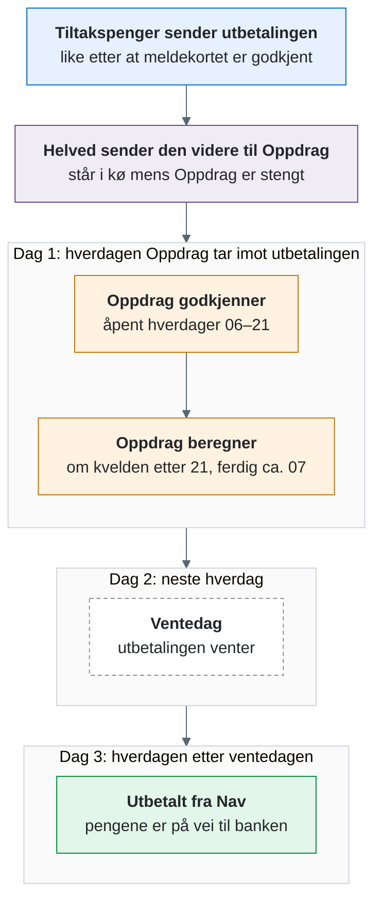
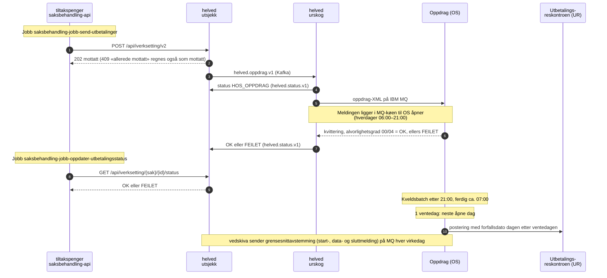

# Utbetalingsflyten: fra vedtak til penger på konto

Denne siden viser hva som skjer fra tiltakspenger sender en utbetaling til pengene er utbetalt, og hvorfor det tar et par dager.
Den første delen er for alle; delen «For utviklere» viser de tekniske detaljene.

## Kort fortalt

- Oppdrag er kortnavnet på Oppdragssystemet, som beregner og betaler ut ytelsene i Nav.
- Tiltakspenger sender utbetalingen like etter at et meldekort eller et vedtak er godkjent, også om kvelden og i helgen.
- Meldekort som behandles automatisk, blir bare behandlet mens Oppdrag er åpent, fordi behandlingen må beregne utbetalingen i Oppdrag først.
- Tiltakspenger og helved tar imot utbetalinger døgnet rundt, men Oppdrag er bare åpent 06:00–21:00 på hverdager og 07:00–18:00 på omtrent to av tre lørdager.
- Oppdragssystemet beregner utbetalingene om kvelden etter stenging, og beregningen skal være ferdig rundt 07:00 neste morgen.
- Tiltakspenger har 1 ventedag i Oppdragssystemet, så utbetalingen blir registrert i Utbetalingsreskontroen tidligst to hverdager etter at den ble godkjent.
- Godkjent betyr ikke utbetalt: utbetalingen kan stoppe senere, for eksempel hvis kontonummer mangler.

### Når blir utbetalingen registrert?

| Sendt | Godkjent | Beregnet | Ventedag | Registrert i reskontroen |
| --- | --- | --- | --- | --- |
| Mandag 14:00 | Mandag | Mandag kveld | Tirsdag | Onsdag |
| Mandag 22:00 | Tirsdag morgen | Tirsdag kveld | Onsdag | Torsdag |
| Fredag 15:00 | Fredag | Fredag kveld | Mandag | Tirsdag |
| Lørdag, vanlig helg | Mandag morgen | Mandag kveld | Tirsdag | Onsdag |
| Lørdag med lørdagsåpent | Lørdag | Søndag kveld | Mandag | Tirsdag |

Helligdager regnes som helg.
Det er ikke avklart hvilken dag pengene står på kontoen, siden det også avhenger av banken.

### Unntak

- Oppdrag har lørdagsåpent 07:00–18:00 på omtrent to av tre lørdager; i 2026 er det 35 av 52.
  Datoene står i Excel-arket [Åpningstider for saksbehandlingssystemer i Nav 2026](https://navno.sharepoint.com/sites/fag-og-ytelser-fagsystemer/_layouts/15/download.aspx?UniqueId=9BACC3BA-6D12-4DD1-AC10-7F6B4100AD20) på [Navet](https://navno.sharepoint.com/sites/fag-og-ytelser-fagsystemer/SitePages/%C3%85pningstider-og-registreringsfrister-i-fagsystemene.aspx), som får nytt ark hvert år.
  En utbetaling som sendes fredag kveld eller lørdag, blir da godkjent lørdag og beregnet søndag kveld, så den kommer én dag tidligere enn i en vanlig helg.
- Det samme gjelder når Oppdrag åpner kort i helgen for vedlikehold: alt som blir godkjent i helgen før søndag 21:00, beregnes søndag kveld.
- Det er ingen beregning lørdag kveld, så en åpen lørdag teller ikke som egen dag i flyten.
- Omtrent én hverdag i måneden stenger systemene kl. 18:00 fordi Oppdrag beregner pensjoner om natten; utbetalinger etter 18 blir da godkjent neste hverdag.
- Åpningstiden kan flyttes, for eksempel rundt helligdager og større produksjonssettinger i økonomiløsningene; endringer publiseres på Navet.

## For utviklere

- `Åpningstider.kt` i saksbehandling-api modellerer åpningstiden som 06:10–20:50 på hverdager som ikke er faste helligdager, med margin mot stengetidene.
  Bevegelige helligdager, lørdagsåpent og vedlikeholdsåpning i helg er ikke med, så modellen treffer uker uten lørdagsåpent og helligdager midt i uka.
- Jobbene `saksbehandling-jobb-send-utbetalinger` og `saksbehandling-jobb-oppdater-utbetalingsstatus` kjører uavhengig av åpningstiden; helved og MQ-køen holder på utbetalingen til OS åpner.
- `AutomatiskMeldekortbehandlingJobb` og `OppdaterUtbetalingsoversiktJobb` står over utenfor `Åpningstider.erInnenforØkonomisystemetsÅpningstider`, fordi simulering og utbetalingsoversikt krever at OS er åpent.
- `Åpningstider.senesteSendetidspunktSomKanStåIReskontroen` regner ut eksemplene i tabellen over.
- Status `FEILET` prøves ikke på nytt og må følges opp manuelt; får en utbetaling ikke OK innen 3 dager, varsler `OppdaterUtbetalingsstatusService`.
- Reverseres en utbetaling innen to virkedager, før posteringene har nådd UR, gir simuleringen tom respons.
- I helved v3 kan en utbetaling angres med `DELETE /utbetalinger/:uid` samme dag før 21:00; vi bruker fortsatt v2.
- Du kontrollerer en utbetaling i OS og UR i Utbetalingsportalen: [utbetalingsportalen.md](utbetalingsportalen.md).

## Kilder

- helved-docs: [Om tjenesten](https://helved-docs.intern.dev.nav.no/kom_i_gang/om_tjenesten), [FAQ](https://helved-docs.intern.dev.nav.no/v3/doc/faq) og [Sjekk status](https://helved-docs.intern.dev.nav.no/kom_i_gang/sjekk_status_pa_utbetaling).
- Koden i [navikt/helved-utbetaling](https://github.com/navikt/helved-utbetaling): `apps/utsjekk`, `apps/urskog` og `dokumentasjon/grensesnittavstemming.md`.
- Confluence: [Hjelp! Noe har gått galt med utbetaling](https://confluence.adeo.no/spaces/TRAFIKKNAVKONTAKTSENTER/pages/800081310) (kjøretider i OS; meldekortytelser beregnes alle hverdager).
- Ventedagen: `Åpningstider.kt` i tiltakspenger-saksbehandling-api.
  Antall ventedager er en innstilling per fagområde i Oppdrag, og TILTPENG har 1 ventedag.
- Søndagsbatch og ventedager som innstilling i Oppdrag: [Årskjøringsplan for FSDRIFT (OS/UR)](https://confluence.adeo.no/spaces/TOB/pages/657867194) på Confluence.
